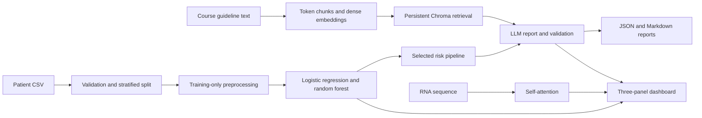
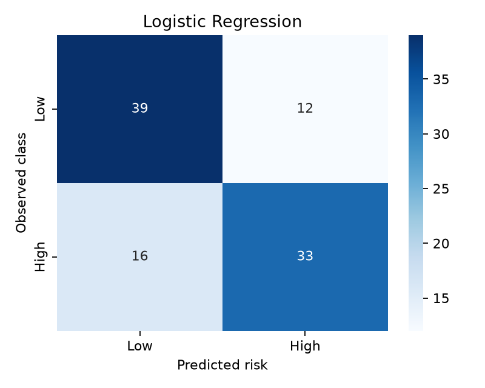
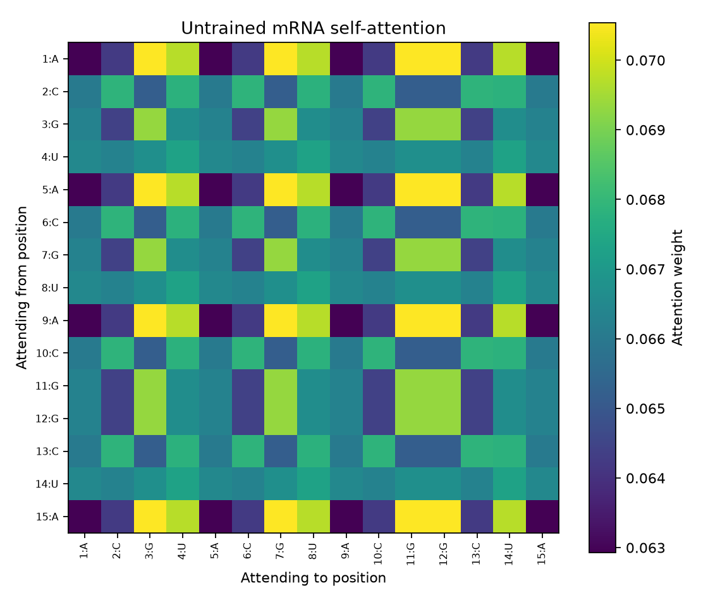
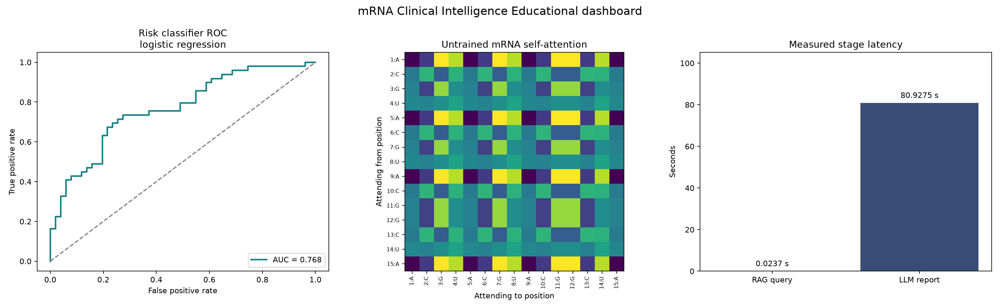

# mRNA vaccine clinical safety and dosage intelligence

## Executive summary

This project combines a tabular risk classifier, a self-attention implementation, semantic retrieval over the supplied course reference, and LLM-generated structured reports. The dataset contains 500 synthetic records. Both classifiers were evaluated on the same stratified holdout, and logistic regression was selected with a positive-class F1 of 0.702. Five reports were generated through an LLM, checked against a strict schema and the retrieved source text, and saved as JSON and Markdown. The final dashboard displays measured classifier performance, computed attention weights and recorded retrieval/report latency. This is an engineering exercise and does not establish clinical validity.

## Architecture



The classifier supplies a risk label and high-risk probability. Retrieval supplies reference excerpts, and the report generator combines those facts with the input features used for prediction. The attention module is a separate mathematical demonstration; its untrained weights do not become clinical evidence. Artifacts needed to rebuild the dashboard are stored locally. The pipeline keeps the reference index on disk so a new process can query it without re-embedding the document.

## Module 1 Data preparation and model results

The input has 20 missing biomarker values and 17 missing reaction-history entries. Blank cells are missing; the literal history category “None” is preserved. Required fields, numeric values, allowed categories, identifiers and target labels are validated before training. Patient ID is excluded from predictors.

A seed-42 stratified 80/20 split gives 400 training records and 100 test records. Median biomarker imputation, modal history imputation, standardization of age/biomarker/dose, and history encoding are fitted only on the training rows. The cleaned CSV uses those training statistics. Both classifiers receive the same inputs and split. This ordering prevents test information from leaking into preprocessing.

| Model | High-risk precision | High-risk recall | High-risk F1 | ROC AUC |
|---|---:|---:|---:|---:|
| logistic regression | 0.733 | 0.673 | 0.702 | 0.768 |
| random forest | 0.640 | 0.653 | 0.646 | 0.714 |

The logistic regression classifier has the higher high-risk F1 and is retained as the final pipeline. F1 balances precision and recall for the high-risk class, which makes the comparison more informative than accuracy alone. The logistic model uses a linear decision boundary, while the forest can represent nonlinear interactions. The scores show how these fitted models behaved on this split; they do not demonstrate biological causation or clinical reliability. As required by the PRD, the holdout score is used for selection, so an independent evaluation set would be needed for an unbiased final estimate.



Of the 51 low-risk holdout records, 39 were correctly classified and 12 were flagged as high risk. Of the 49 high-risk records, 33 were detected and 16 were missed, so the model cannot reliably rule out risk. Confusion-matrix rows are observed labels and columns are predictions. Per-class precision, recall, F1 and support for both classifiers are stored in figures/model_metrics.json. That file also holds the numerical confusion matrices and ROC coordinates used by the dashboard. The saved risk_model.joblib contains the selected classifier and its fitted preprocessing, ensuring consistent inference after reload.

## Module 2 Self-attention

Each nucleotide starts as an eight-dimensional vector from a fixed random embedding table. Stacking these vectors produces a sequence-length by eight input matrix. Three independently initialized projection matrices transform that input into queries Q, keys K, and values V. A query describes what a position matches against, a key describes the representation it offers for matching, and a value is the information mixed into the output. These are mathematical roles in this toy computation, not measured biological properties.

Multiplying Q by the transpose of K gives one score for every ordered pair of positions. Dividing those scores by the square root of the key dimension controls their scale. For numerical stability, the implementation subtracts each row's largest score before exponentiating. Row-wise softmax then makes every weight nonnegative and makes each row sum to one. Multiplying this weight matrix by V yields a weighted combination of value vectors for each position.

The heatmap displays those weights: a row is an attending position and a column is a position being attended to. Repeated bases have identical rows because this example has no positional encoding. The weights are untrained and nearly uniform, so their visual pattern does not establish RNA structure, sequence function, or biological interactions. A separate PyTorch calculation checks the NumPy implementation using the same projections.

Observed strongest base matches: A→G (0.07054); C→C (0.06787); G→G (0.06932); U→U (0.06732). These preferences reflect the fixed random projections, not learned biology.



The low-level encoder supports the four-base acceptance example in the handout, while the application enforces the stated 5–50-base input limit. Any character outside A, C, G and U raises an explicit error. The implementation uses fixed seeds so repeated runs yield identical matrices, and the NumPy calculation is checked against PyTorch.

## Module 3 Retrieval results

The guideline text was extracted from the supplied Word reference. It is split into 4 chunks with token counts [349, 350, 349, 346]. Adjacent chunks share 50 embedding-token positions. The final tail is balanced so every chunk satisfies the required 300–500-token range. Source character offsets preserve verbatim text for quotation checks. The MiniLM embedding model has its inference limit set to 512 within its positional capacity, preventing truncation of these chunks.

Dense normalized vectors, source text and offsets are persisted in ChromaDB. A query is embedded with the same model and retrieves the three nearest chunks by cosine distance. The saved retrieval_evaluation.md contains five realistic questions, their actual top excerpts and measured query times. It also documents an unsupported question about malaria efficacy: the search returns nearest neighbors even though the source does not contain an efficacy percentage. This illustrates why similarity alone cannot establish answerability.

Chunk overlap helps preserve facts near boundaries, but the relatively broad chunks may mix storage, dose and precaution topics. A top result can therefore contain relevant facts alongside unrelated material. The tests check expected source phrases as a transparent diagnostic, not as a comprehensive semantic-quality score. Report generation must still use only facts present in the retrieved text and abstain if those facts cannot support a decision.

| Question | Top result | Seconds |
|---|---|---:|
| How long can thawed product stay refrigerated? | [chunk-001](retrieval_evaluation.md#chunk-001) | 0.0202 |
| What dose requires secondary clinician review? | [chunk-002](retrieval_evaluation.md#chunk-002) | 0.0211 |
| What is an absolute contraindication involving a severe allergy? | [chunk-003](retrieval_evaluation.md#chunk-003) | 0.0215 |
| When must moderate or severe adverse events be documented? | [chunk-003](retrieval_evaluation.md#chunk-003) | 0.0123 |
| Can thawed vials be refrozen? | [chunk-001](retrieval_evaluation.md#chunk-001) | 0.0113 |

The following is the verbatim top chunk (chunk-002) for the dose-review question in the recorded evaluation:

> therapeutic products is generally determined by age, body weight where applicable, and the specific clinical indication. As a general reference range across mRNA vaccine platforms, primary-series doses commonly fall between 25 and 100 micrograms, while booster or lower-reactogenicity formulations are frequently dosed between 25 and 50 micrograms. Doses above 100 micrograms are considered high-reactogenicity doses and require secondary clinician review before administration.
> 2.2 Age-Banded Reference Doses
> Ages 6 months to 4 years: lowest available dose tier; administration requires pediatric-formulated product and is not interchangeable with adult vials.
> Ages 5 to 11 years: intermediate pediatric dose tier, generally half the standard adult dose.
> Ages 12 to 64 years: standard adult dosing range as listed in Section 2.1.
> Ages 65 and older: standard adult dosing range applies; however, patients in this age band with two or more relevant pre-existing conditions should be flagged for secondary clinician review regardless of dose, due to elevated reactogenicity risk observed in this population.
> 2.3 Dose Adjustment for Elevated Biomarker Levels
> Patients presenting with an inflammatory biomarker level meaningfully above the normal reference range at the time of screening should have dosing deferred until the biomarker returns to a normal range, or should receive the lowest clinically appropriate dose tier with enhanced post-administration monitoring, at the administering clinician's discretion.
> Section 3: Contraindications and Warnings
> 3.1 Absolute Contraindications
> Known severe allergic reaction (e.g., anaphylaxis) to a prior dose of the same product or to any component of the formulation, including the lipid nanoparticle exci

## Module 4 Structured report

The LLM receives the risk output, its patient features and the retrieved excerpts. The prompt prohibits invented metrics, guidelines and dose bounds. It requires conservative eligibility when evidence is insufficient and the exact safety disclaimer. The first reasoning entry must reproduce the actual risk label and probability supplied by Module 1. Every response is parsed into a Pydantic model with exactly five fields; extra keys, mistyped values, negative or non-finite doses, and an incorrect disclaimer are rejected. A validation failure triggers exactly one retry. An additional failure raises a clear error without saving an invalid report.

Citations must be exact substrings of retrieved course text. Explicit numeric maximum-dose statements are checked separately from review thresholds. The supplied reference calls doses above 100 micrograms high-reactogenicity doses requiring secondary review; this is not an absolute maximum. The implementation converts micrograms to milligrams before comparison. Deterministic checks withhold eligibility for review conditions and insufficient patient-specific evidence. A zero output dose indicates no recommendation, never a treatment instruction.

The following is the full saved report for P0001. Its risk-related statement is grounded in the classifier output, and its quoted warnings come from the retrieved reference. The field name FDA_Safety_Warnings_Cited is retained to satisfy the specified schema; the quotations are from a course reference, not an FDA publication.

```json
{
  "Eligible_For_Vaccine": false,
  "Recommended_Dose_mg": 0.0,
  "Reasoning_Steps": [
    "Model 1 predicts Low risk; high-risk probability = 0.331993.",
    "The generated eligibility recommendation was rejected by the safety checks.",
    "Conservative project policy withholds eligibility because the retrieved guidance requires information absent from the input: component-allergy clearance, the clinical indication, a patient-specific biomarker reference range. Unknown information does not establish that a clinical contraindication is present."
  ],
  "FDA_Safety_Warnings_Cited": [
    "Patients should be monitored for at least 15 minutes following administration, or 30 minutes for patients with a documented history of any allergic reaction.",
    "Systemic reactions such as fever, chills, or fatigue lasting more than 48 hours should be documented and reported.",
    "As a general reference range across mRNA vaccine platforms, primary-series doses commonly fall between 25 and 100 micrograms, while booster or lower-reactogenicity formulations are frequently dosed between 25 and 50 micrograms.",
    "Known severe allergic reaction (e.g., anaphylaxis) to a prior dose of the same product or to any component of the formulation, including the lipid nanoparticle excipients.",
    "Dose selection for mRNA therapeutic products is generally determined by age, body weight where applicable, and the specific clinical indication.",
    "Patients presenting with an inflammatory biomarker level meaningfully above the normal reference range at the time of screening should have dosing deferred until the biomarker returns to a normal range, or should receive the lowest clinically appropriate dose tier with enhanced post-administration monitoring, at the administering clinician's discretion."
  ],
  "Disclaimer": "Student engineering project output — not real clinical guidance."
}
```

All five patient reports are stored as matching JSON/Markdown pairs. The generated wording is subject to schema, citation and safety checks, but exact quotation matching alone cannot prove that every free-text inference is entailed by the source.

## Dashboard



The three panels are the selected model’s ROC curve, the computed attention matrix and a latency comparison. The image is saved at 160 DPI. Mean retrieval time is 0.0237 seconds and mean LLM report-generation time is 80.9275 seconds across five patient reports. Each underlying measurement is retained in latencies.json. Query timing includes embedding and search; report timing includes the LLM response and validation, including a validation retry if one occurs. Model loading, initial indexing and file writes are excluded.

## Limitations and future work

1. Five hundred synthetic records cannot establish clinical performance. Independent data, external evaluation, subgroup analysis and probability calibration would be needed before drawing real-world conclusions.
2. Choosing the winning model on test F1 follows the PRD but biases the reported comparison. A stronger experiment would select by cross-validation and reserve a separate untouched final holdout.
3. The course reference is general and is not authoritative regulatory guidance. It lacks numeric pediatric dose tiers and biomarker normal ranges, and the input records do not establish allergy clearance or clinical indication. The system conservatively abstains instead of supplying those facts.
4. Five supported retrieval questions and one unsupported question offer limited coverage. A larger labeled evaluation set would help compare chunk sizes, embedding models, redundancy and abstention behavior.
5. Exact-citation and schema checks constrain output format and provenance, but do not eliminate unsupported interpretation. Broader groundedness evaluation and clinician-independent software review would improve the engineering demonstration.
6. Randomly initialized attention is not a biological model. A meaningful sequence-learning task would require a defined training objective, positional information, suitable data and independent validation.

## Reproduction

```bash
python3 -m venv .venv
source .venv/bin/activate
python -m pip install -r requirements.txt
# Configure LLM_API_KEY, LLM_MODEL and LLM_BASE_URL in private .env.
python -m src.pipeline
python -m pytest -q
```

The first retrieval run downloads the public embedding model. The model cache and persistent index are reused on later runs. The two notebooks cover data exploration and self-attention mathematics; select the project virtual environment as their Python kernel. Individual modules can be run with python src/risk_model.py, python src/attention.py, python src/rag_index.py, python src/report_generator.py and python src/dashboard.py. The LLM key is read and used only by Module 4. The dashboard consumes the saved metrics, attention array and latency measurements. Credentials belong only in the ignored .env file.
